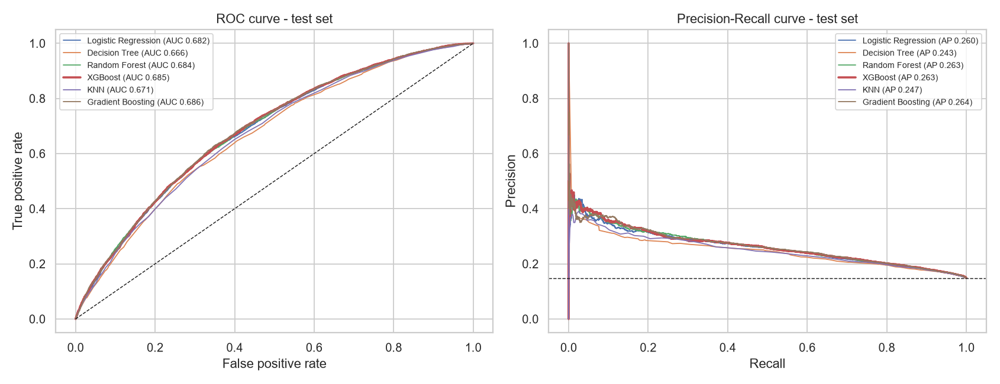
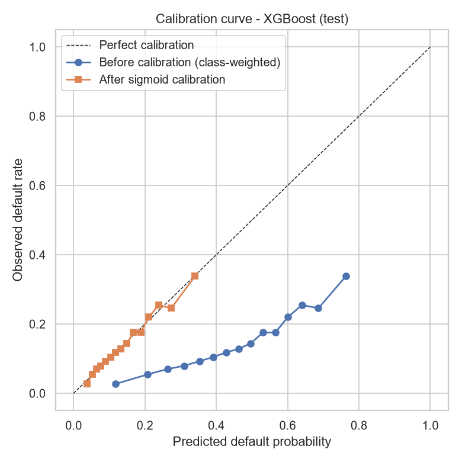
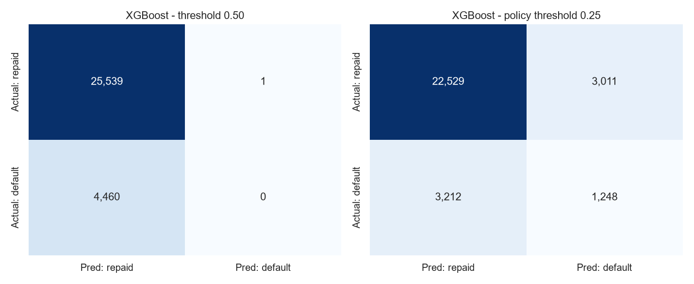
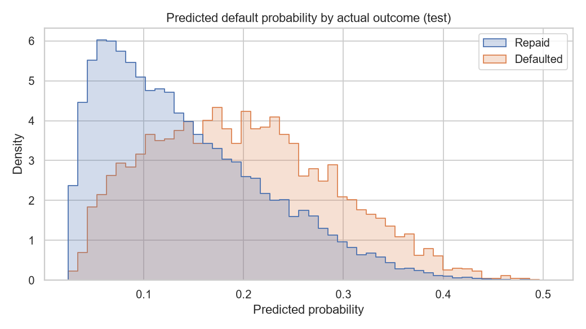
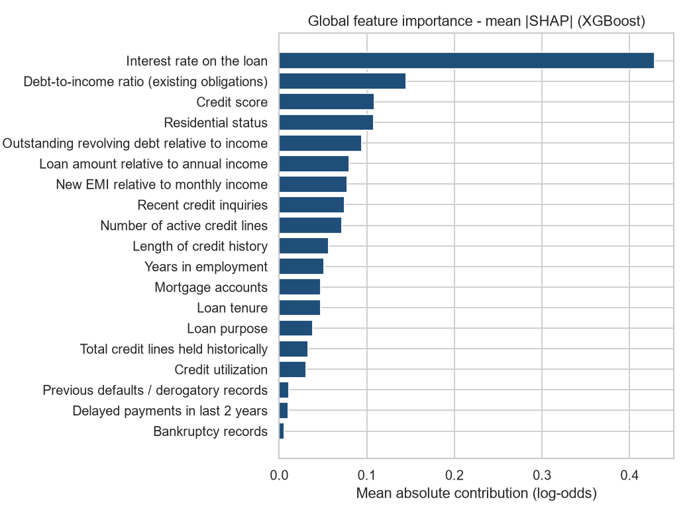

# Model Evaluation Report

*Generated 2026-11-19T19:24:06+00:00 by `python -m loanrisk.train`. All numbers below are computed, not typed.*

## Data split

- Training: 90,000 loans (model fitting and 5-fold stratified CV on a 50,000-loan subsample)
- Validation: 30,000 loans (sigmoid probability calibration and model selection)
- Test: 30,000 loans (held out; used once for the numbers in this report)
- Overall default rate: 14.87%

## Model comparison

| Model | CV ROC-AUC | CV PR-AUC | Train AUC | Valid AUC | Gap | Valid Brier (raw → calibrated) | Test ROC-AUC | Test PR-AUC | Test Brier |
|---|---|---|---|---|---|---|---|---|---|
| Logistic Regression | 0.6789 ± 0.0070 | 0.2577 | 0.6678 | 0.6814 | -0.0136 | 0.2248 → 0.1198 | 0.6820 | 0.2603 | 0.1200 |
| Decision Tree | 0.6595 ± 0.0040 | 0.2375 | 0.6761 | 0.6666 | +0.0095 | 0.2284 → 0.1210 | 0.6662 | 0.2432 | 0.1210 |
| Random Forest | 0.6801 ± 0.0056 | 0.2571 | 0.7455 | 0.6856 | +0.0600 | 0.2093 → 0.1195 | 0.6839 | 0.2625 | 0.1196 |
| XGBoost **(selected)** (monotonic) | 0.6788 ± 0.0060 | 0.2572 | 0.6984 | 0.6866 | +0.0118 | 0.2211 → 0.1193 | 0.6848 | 0.2634 | 0.1196 |
| KNN | 0.6654 ± 0.0075 | 0.2412 | 0.6772 | 0.6674 | +0.0099 | 0.1209 → 0.1210 | 0.6712 | 0.2469 | 0.1211 |
| Gradient Boosting | 0.6810 ± 0.0045 | 0.2600 | 0.6916 | 0.6874 | +0.0043 | 0.2221 → 0.1192 | 0.6857 | 0.2635 | 0.1195 |

Selection rule: highest mean(CV ROC-AUC, validation ROC-AUC) rounded to 3dp, ties broken by lower calibrated validation Brier score; the monotonic-constrained XGBoost is preferred if it is within 0.005 AUC of the leader (about one CV standard deviation), because its explanations are guaranteed to move in the economically expected direction.

## Selected model: XGBoost (test set)

- ROC-AUC: **0.6848** (95% bootstrap CI 0.6776 – 0.6919)
- PR-AUC: **0.2634** (baseline = default rate 0.1487)
- Brier score: **0.1196** (before calibration 0.2230)

### Policy threshold (probability > 0.25 = not auto-approved)

| Accuracy | Precision | Recall | F1 | False-negative rate | False-positive rate |
|---|---|---|---|---|---|
| 0.7926 | 0.2930 | 0.2798 | 0.2863 | 0.7202 | 0.1179 |

Confusion matrix: TN=22,529  FP=3,011  **FN=3,212**  TP=1,248

### Threshold 0.50

| Accuracy | Precision | Recall | F1 | False-negative rate | False-positive rate |
|---|---|---|---|---|---|
| 0.8513 | 0.0000 | 0.0000 | 0.0000 | 1.0000 | 0.0000 |

Confusion matrix: TN=25,539  FP=1  **FN=4,460**  TP=0

**False negatives** are actual defaulters the model scored as safe. At the 0.50 threshold most defaulters are missed, which is why the decision policy routes everything above the approve threshold to review or rejection; accuracy alone is misleading on an imbalanced dataset (a model that approves everyone would score 85.1% accuracy).

## Calibration by risk decile (test)

| Predicted range | n | Mean predicted | Observed default rate (95% CI) |
|---|---|---|---|
| 0.024 – 0.042 | 1,500 | 0.035 | 0.022 (0.016 – 0.031) |
| 0.042 – 0.052 | 1,500 | 0.047 | 0.051 (0.041 – 0.063) |
| 0.052 – 0.061 | 1,500 | 0.057 | 0.059 (0.048 – 0.072) |
| 0.061 – 0.071 | 1,500 | 0.066 | 0.070 (0.058 – 0.084) |
| 0.071 – 0.080 | 1,500 | 0.075 | 0.075 (0.063 – 0.090) |
| 0.080 – 0.090 | 1,499 | 0.085 | 0.079 (0.067 – 0.094) |
| 0.090 – 0.100 | 1,501 | 0.095 | 0.099 (0.085 – 0.115) |
| 0.100 – 0.111 | 1,500 | 0.105 | 0.115 (0.100 – 0.132) |
| 0.111 – 0.122 | 1,500 | 0.116 | 0.119 (0.104 – 0.137) |
| 0.122 – 0.133 | 1,500 | 0.127 | 0.117 (0.102 – 0.135) |
| 0.133 – 0.145 | 1,500 | 0.139 | 0.150 (0.133 – 0.169) |
| 0.145 – 0.159 | 1,500 | 0.152 | 0.135 (0.118 – 0.153) |
| 0.159 – 0.173 | 1,500 | 0.166 | 0.172 (0.154 – 0.192) |
| 0.173 – 0.188 | 1,500 | 0.180 | 0.182 (0.163 – 0.202) |
| 0.188 – 0.205 | 1,500 | 0.197 | 0.189 (0.170 – 0.210) |
| 0.205 – 0.224 | 1,500 | 0.214 | 0.219 (0.198 – 0.240) |
| 0.224 – 0.246 | 1,500 | 0.235 | 0.253 (0.231 – 0.275) |
| 0.246 – 0.273 | 1,500 | 0.259 | 0.238 (0.217 – 0.260) |
| 0.273 – 0.312 | 1,500 | 0.291 | 0.273 (0.251 – 0.296) |
| 0.312 – 0.506 | 1,500 | 0.353 | 0.355 (0.332 – 0.380) |

## Global feature importance (mean |SHAP|)

Importance shows how strongly the model *relies* on a feature; it is an association learned from historical data, not proof that the feature causes default.

- Interest rate on the loan: 0.4286
- Debt-to-income ratio (existing obligations): 0.1449
- Credit score: 0.1087
- Residential status: 0.1079
- Outstanding revolving debt relative to income: 0.0944
- Loan amount relative to annual income: 0.0796
- New EMI relative to monthly income: 0.0777
- Recent credit inquiries: 0.0741
- Number of active credit lines: 0.0716
- Length of credit history: 0.0564
- Years in employment: 0.0511
- Mortgage accounts: 0.0476
- Loan tenure: 0.0471
- Loan purpose: 0.0380
- Total credit lines held historically: 0.0326
- Credit utilization: 0.0307
- Previous defaults / derogatory records: 0.0113
- Delayed payments in last 2 years: 0.0103
- Bankruptcy records: 0.0058

## Fairness audit (test set, default policy thresholds)

Protected attributes (gender, religion, caste, race, age, marital status) are not in the training data and are never used as features. Geography is excluded from the model because it can proxy for protected characteristics; it is used below only to audit outcomes. Approval ratio < 0.8 (the 'four-fifths rule') flags a potential disparate impact worth investigating.

### US region (audit only - not a model feature)

| Group | n | Actual default | Mean predicted | Approval rate | Approval ratio | FNR | FPR | AUC |
|---|---|---|---|---|---|---|---|---|
| Midwest | 5,129 | 0.149 | 0.150 | 0.852 | 0.99 | 0.706 | 0.122 | 0.682 |
| Northeast | 6,187 | 0.154 | 0.149 | 0.857 | 0.99 | 0.726 | 0.120 | 0.685 |
| South | 10,554 | 0.144 | 0.149 | 0.863 | 1.00 | 0.734 | 0.115 | 0.672 |
| West | 8,130 | 0.150 | 0.151 | 0.857 | 0.99 | 0.707 | 0.117 | 0.702 |

### Residential status

| Group | n | Actual default | Mean predicted | Approval rate | Approval ratio | FNR | FPR | AUC |
|---|---|---|---|---|---|---|---|---|
| Mortgaged | 14,422 | 0.126 | 0.130 | 0.904 | 1.00 | 0.790 | 0.080 | 0.695 |
| Owned | 3,022 | 0.158 | 0.152 | 0.854 | 0.95 | 0.744 | 0.125 | 0.655 |
| Rented | 12,549 | 0.172 | 0.172 | 0.806 | 0.89 | 0.656 | 0.162 | 0.670 |

### Income quartile

| Group | n | Actual default | Mean predicted | Approval rate | Approval ratio | FNR | FPR | AUC |
|---|---|---|---|---|---|---|---|---|
| Q1 (lowest) | 7,549 | 0.191 | 0.176 | 0.797 | 0.86 | 0.684 | 0.176 | 0.639 |
| Q2 | 7,451 | 0.154 | 0.159 | 0.838 | 0.91 | 0.670 | 0.131 | 0.684 |
| Q3 | 7,562 | 0.138 | 0.143 | 0.875 | 0.95 | 0.750 | 0.106 | 0.692 |
| Q4 (highest) | 7,438 | 0.112 | 0.120 | 0.923 | 1.00 | 0.816 | 0.064 | 0.697 |

### Employment length

| Group | n | Actual default | Mean predicted | Approval rate | Approval ratio | FNR | FPR | AUC |
|---|---|---|---|---|---|---|---|---|
| <2 yrs | 4,518 | 0.145 | 0.151 | 0.856 | 0.97 | 0.702 | 0.118 | 0.702 |
| 2-4 yrs | 6,913 | 0.149 | 0.148 | 0.868 | 0.99 | 0.740 | 0.110 | 0.690 |
| 5-9 yrs | 7,487 | 0.153 | 0.155 | 0.845 | 0.96 | 0.694 | 0.128 | 0.683 |
| 10+ yrs | 9,427 | 0.135 | 0.142 | 0.879 | 1.00 | 0.755 | 0.101 | 0.679 |

## Limitations

- Trained on US peer-to-peer loans (LendingClub, 2007-2015 originations). Applicants in other markets (e.g. Indian retail lending) may behave differently; the model should be re-trained or at least re-calibrated on local outcome data before any real use.
- Credit scores in training are FICO (approx. 630-850 because LendingClub declined lower scores). Scores below that range are extrapolation; the app flags them and the policy layer escalates them.
- Only approved-and-funded loans have outcomes (reject inference / selection bias).
- Interest rate is the most influential input; LendingClub priced loans from its own grade, so the rate partly encodes the lender's risk view. Remove it and retrain if rates are set after the risk assessment.
- Inputs such as savings, bank balance, monthly expenses, dependents and employment type are not in the training data, so they are used only in the rule-based affordability policy, never by the model.
- This is an educational decision-support prototype; outputs are recommendations, not lending decisions.